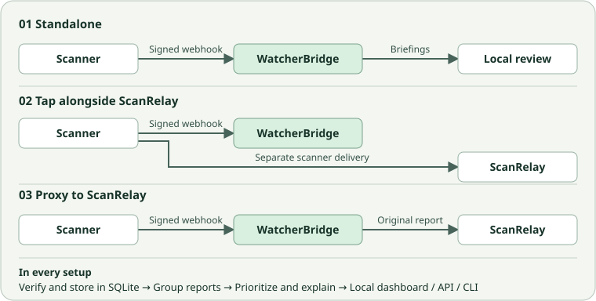
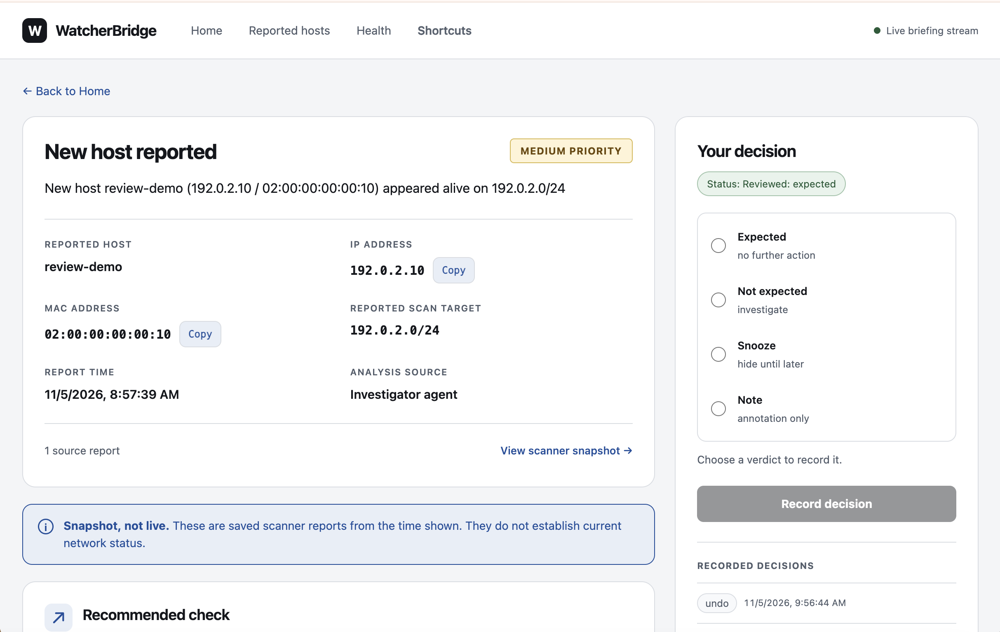
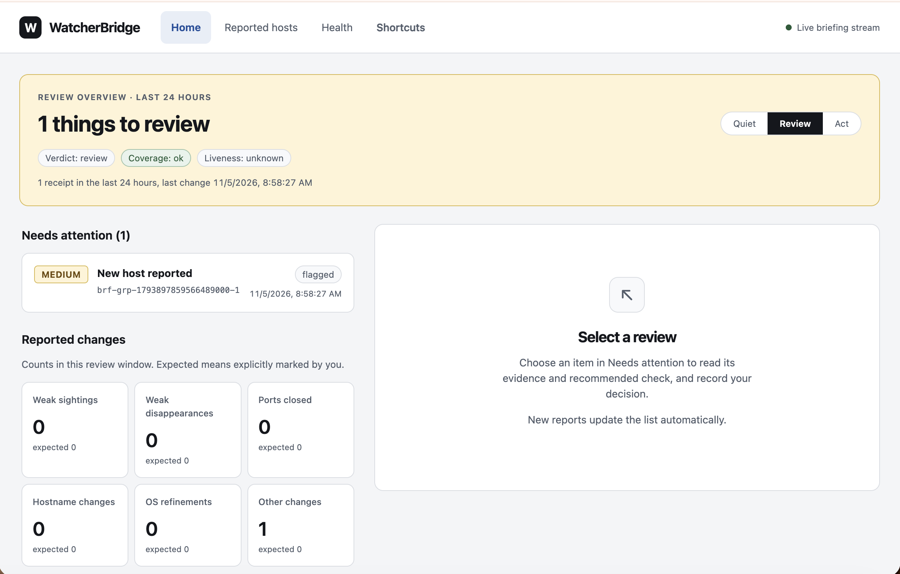

# WatcherBridge

Network scanners tell you what’s happening. But what does it actually mean? I already had **SubnetLens Pro**, my proprietary network scanner, which is built on top of open-source [SubnetLens](https://github.com/ostefani/subnetlens). Its watch mode detected and reported network changes and **ScanRelay** displayed the events. I still had to piece together why those changes mattered and what to check next.

I built **WatcherBridge** to fill that gap. It receives signed reports from a network scanner and turns them into a local review inbox, with plain explanations of what changed, why it matters, and what to check next. I used SubnetLens Pro as the event source for this project. The demo can use synthetic reports, so reviewers can try it without a scanner or real network data.

## Building notes

Biggest obstacle during the hackathon: repeated power and internet outages in the final days of the build. I worked in short windows when connected, and submitted before the deadline. Wasn't able to update the submission form to add this note there due to the outage too.

## Deployment modes

- **Standalone** (`-mode tap -scanrelay-url=`). The scanner sends signed reports to WatcherBridge. Local briefings and review work without ScanRelay.
- **Parallel tap** (`-mode tap`, the default). Configure the scanner with separate endpoints for WatcherBridge and ScanRelay. The scanner delivers to each independently.
- **Proxy** (`-mode proxy -scanrelay-url=<url>`). WatcherBridge verifies and stores each accepted change report before forwarding the original body and signature headers to ScanRelay's `/webhook`. Proxy mode requires a relay URL.

A configured relay URL also enables a separate briefing annotation publisher in either mode. Heartbeats terminate at WatcherBridge and update local source coverage, including in proxy mode.

## Screenshots

The screenshots below use synthetic demonstration data.

**Briefing detail.** Inspect reported identity and priority, open saved scanner evidence, and record an operator decision.
**Home overview.** Find reports needing attention and select an item to review its evidence and recommended check.
<table>
<tr>
<td></td>
<td></td>
</tr>
</table>

## What it does

- **Keeps the scanner evidence.** WatcherBridge verifies signatures, preserves the original reports, and uses the context the scanner supplies. Network discovery and host identification belong to the scanner.
- **Explains and prioritizes changes.** Briefings link to the underlying reports and explain what changed, why it matters, and what to check next. Local rules set priority. Optional AI can consult retained evidence through bounded, read-only tools and may raise priority by one level, up to high.
- **Groups related briefings into incidents.** Qualifying appearance or disappearance briefings from the same source and scan target can form an incident. The highest member priority sets the minimum, with a floor of medium for disappearance incidents.
- **Keeps review decisions local.** Mark changes expected or unexpected, snooze items, or add notes and labels. Three matching, eligible “expected” decisions can trigger a rule proposal. Operators can approve it with an optional expiry or revoke an active rule.
- **Shows attention and coverage.** The overview pairs an **Act**, **Review**, or **Quiet** verdict with coverage for each source. Liveness is unknown until heartbeat support is established. After that, a stale heartbeat is flagged as blind even if another source is healthy. The overview is available in the dashboard, JSON API, and status CLI.
- **Protects data sent to AI providers.** Redaction is enabled by default, and a final leak scan can block transmission. Model failures produce a clearly marked explanation based on local rules.

## Run the AI demo

See the [reviewer guide](docs/reviewer-guide.md) for setup and copy-paste
commands to run the Meta AI demo. The synthetic reports let you try it without
a scanner or real network data. You can also use SubnetLens Pro as the event source.

## Operation and development

- Run `./watcherbridge -h` for startup settings and `./watcherbridge status --window 24h --json` for the running bridge's overview. Status exits with `0` for quiet, `1` for review, `2` for act, or `3` when unavailable.
- The listener accepts loopback addresses only. A quiet verdict describes retained reports and review state, not network security or host availability.
- Built with Go, SQLite in WAL mode, Svelte 5, Vite, and Server-Sent Events. Use the Node.js version in [ui/.nvmrc](ui/.nvmrc) and `make ui-check` for viewer changes.

See [CONTRIBUTING.md](CONTRIBUTING.md) for engineering conventions.

## Submission scope

This submission consists solely of WatcherBridge, built during the hackathon. SubnetLens Pro and ScanRelay are external integrations and are not part of the submission.

## License

MIT © 2026 Olha Stefanishyna
